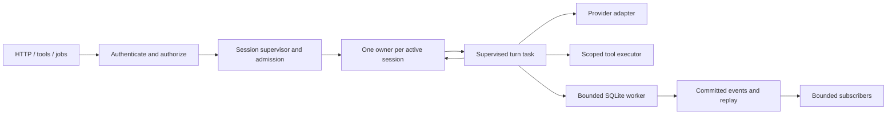

# Rust gateway foundation

Decision date: 2026-10-18. Scope: the isolated native implementation in
`packages/gateway-rust`. The installed TypeScript gateway remains the production
runtime. This document establishes the construction plan; it does not assert
feature parity or measured performance improvement.

## Architecture decision

Build a modular monolith: one native process, one Cargo workspace, initially one
library/binary crate with domain modules. Keep HTTP adapters thin and domain
services independent of Axum. Share database workers, outbound clients, budgets
and lifecycle infrastructure across domains.

Considered alternatives:

| Approach | Benefit | Cost / decision |
| --- | --- | --- |
| One crate with explicit domain modules | Fast refactoring, simple local deployment, no IPC or cross-crate API churn | Selected; enforce ownership in reviews and extract crates when a real reuse boundary appears |
| Separate crate per domain immediately | Strong compile-time dependency boundaries | Too many public interfaces before domain ports settle; defer |
| Separate services/processes | Independent scaling and crash isolation | IPC, deployment and authorization complexity for a local workbench; reserve child processes for engines/providers that already need them |

The dependency direction is `routes/transport -> services/domain -> db/security/contracts`.
Runtime composes these pieces. Contracts contain serializable data and no storage,
transport or executable behavior. Policy is enforced at effects, including node
destinations and scheduled execution. Domain code must not import HTTP handlers.
Use small concrete structs and enums; add traits at genuine replaceable I/O seams,
not for every service. Avoid a dependency injection framework or a global mutable
service registry.

## Chosen technology baseline

Existing versions remain pinned in Cargo.lock. Add selected future dependencies
with their first working adapter, review features/licenses, and commit the updated
lockfile. A decision in this table is not a claim that its integration exists.

| Layer | Choice | Reason and adoption status |
| --- | --- | --- |
| Language/build | Stable Rust, edition 2024, minimum 1.98; Cargo workspace | Existing toolchain contract. Native binary; Node/Bun are development/reference-test tools only |
| Async I/O | Tokio 1.x | Existing runtime; one shared runtime for sockets, timers and tasks |
| HTTP/server | Axum 0.8 on Hyper; Tower / tower-http middleware | Axum is present. Adopt middleware per contract; HTTP/WS/SSE share the same server |
| Data/wire formats | Serde + serde_json | Present; preserve exact naming, missing/null distinctions and error shapes. Typed DTOs at new boundaries |
| Storage | rusqlite 0.40 with bundled SQLite + backup | Present; reuse SQL/migrations, WAL, foreign keys and existing files. Keep SQL explicit; no ORM/second SQLite stack |
| Outbound HTTP/TLS | reqwest with rustls, native certificate roots | Selected for adapters; harness already uses reqwest. Reuse pooled clients per policy, disable implicit proxies/redirects for scoped requests, validate resolved destinations. No ambient trust or proxy inheritance without explicit policy |
| Lifecycle | Tokio primitives now; tokio-util CancellationToken / TaskTracker for domain tasks | Native server already drains with a five-second ceiling. Introduce shared cancellation/tracking as background domains land; cancellation cannot abort running blocking work |
| Logging/diagnostics | tracing + tracing-subscriber JSON | Selected; current lifecycle JSON remains. Add spans through an allowlisted field API; never log bodies, keys, tokens or raw evidence |
| Errors | Domain enums; thiserror for implementations, boxed errors only at process/adapter edges | Selected; retain existing HTTP envelopes and avoid forwarding internal error strings to clients |
| Identity/crypto | jsonwebtoken HS256, scrypt, sha2, getrandom, subtle | Present for compatibility. No hand-written cryptographic algorithms; preserve fixed password parameters and strict token policy |
| CLI/config | clap derive when native commands land; typed config with explicit precedence | Bootstrap config is present. Preserve existing CLI/environment/config behavior during the CLI port; no silently new precedence |
| Tests/performance | cargo test + existing Rust-owned differential harness; Criterion for CPU microbenchmarks when justified | Reference suites already exist. End-to-end latency/RSS/startup need process-level matched workloads, not microbenchmarks alone |
| Security engines/integrations | Typed native adapters around existing executable/protocol engines | Preserve Nmap/Nuclei/Trivy profiles and provenance. Select transport-specific libraries with those adapters; do not bundle every SDK into the base binary |

Primary references: [Axum](https://docs.rs/axum/latest/axum/),
[Tokio blocking work](https://docs.rs/tokio/latest/tokio/task/fn.spawn_blocking.html),
[rusqlite](https://docs.rs/rusqlite/latest/rusqlite/),
[reqwest](https://docs.rs/reqwest/latest/reqwest/),
[cancellation](https://docs.rs/tokio-util/latest/tokio_util/sync/struct.CancellationToken.html),
[structured diagnostics](https://docs.rs/tracing-subscriber/latest/tracing_subscriber/fmt/index.html).

## Directory ownership

All of these module directories exist and are declared in the library. Reserved
modules contain documentation only, with no success-returning stubs or registered
routes. Creating the skeleton earns no migrated-component credit.

```text
packages/gateway-rust/
  Cargo.toml / Cargo.lock   workspace, features, locked dependencies, build profiles
  build.rs                 existing package-version compatibility
  run.mjs / tooling/       development and verification entrypoints
  src/
    main.rs                process entry, bootstrap, signals
    lib.rs                 composition exports and module declarations
    config.rs              typed bootstrap configuration
    runtime/               server lifecycle and shared bounded blocking work
    contracts/             request/response DTOs and event/protocol envelopes
    routes/                HTTP adapters and wire-compatible errors
    transport/             SSE, WebSocket, outbound connection policies
    db/                    SQLite, schema, migrations, transactions, identifiers
    security/              identity, ownership, consent, path/SSRF/scope enforcement
    services/              persisted application services (users, then sessions etc.)
    providers/             model protocols, capabilities and streamed events
    execution/             tool dispatch, processes, PTY, filesystem and OS effects
    coordination/          turns, agents, teams, threads and task ownership
    nodes/                 trust, routing, remote execution and vantage
    scheduler/             durable jobs, timers and recovery
    memory/                scoped recall, search, provenance and retention
    assessments/           scoped engines, evidence, findings and verification
    integrations/          mail/calendar/channels, browser, voice and plugins
    surfaces/              assets, preview and surface lifecycle
    observability/         redacted diagnostics and resource instrumentation
    health.rs              existing health contract
    state_directory.rs     existing state-path compatibility
  native-coverage.json      verified component ledger, separate from scaffold
```

Keep the existing services/routes/db/security paths stable while migration
contracts reference them. Group large domains into submodules as they are ported;
do not create a file for every historical TypeScript helper in advance. Shared TS
schemas remain the behavioral reference; add Rust DTO mappings with contract
checks, then automate schema/client generation after the format is established.

## Session ownership and concurrency

Review date: 2026-10-24. This review extends the foundation decision for agents working on R09–R27.
The design below is the migration direction; it is not a claim that the full
session supervisor, task tree or parallel tool scheduler exists. Keep observable
TypeScript behavior under differential tests. A change to ordering, overload,
disconnect, retry or recovery behavior needs an explicit compatibility decision
and client tests; do not silently change a contract while refreshing fingerprints.

### Starting points in the current code

| Evidence | Existing behavior / opportunity |
| --- | --- |
| [TypeScript chat route](../packages/gateway/src/routes/chat.ts) | History, abort controllers, CLI provider sessions, subscribers, event buffers, flush timers and steering occupy separate maps. Consolidate lifecycle rules rather than translating every map into a shared mutex |
| [Native turn manager](../packages/gateway-rust/src/runtime/chat_sessions.rs) | Per-session exclusion and global semaphore admission already exist. The lease spans history loading, generation, tools and persistence; it is not a complete session owner |
| [Native chat adapter](../packages/gateway-rust/src/routes/chat.rs) | HTTP also tracks active turns, cancellation and completion. Compose this with domain ownership so HTTP, tools and background entrypoints cannot develop different lifecycle rules |
| [Native turn coordinator](../packages/gateway-rust/src/runtime/chat_turn.rs) | Tool calls currently run sequentially with authenticated context, cancellation and bounded results. Preserve this safe default while defining which effects can overlap |
| [Native event bus](../packages/gateway-rust/src/runtime/chat_events.rs) and [turn store](../packages/gateway-rust/src/runtime/chat_store.rs) | Committed events have durable IDs; subscription starts before replay. Preserve this ordering and deduplication when changing fan-out or ownership |
| [Database worker](../packages/gateway-rust/src/db/worker.rs) and [blocking lane](../packages/gateway-rust/src/runtime/blocking.rs) | Bounded work admission and dedicated SQL execution are reusable foundations. Do not create another pool or worker for every session |

These are source observations from this review, not new parity or performance
results. Audit the live ledger and source fingerprints before claiming coverage.

### One owner per active session

Use a runtime-owned session supervisor and one owner task per active session,
created lazily and evicted after bounded idle cleanup. A session is durable domain
state; a browser connection is a subscriber, and a turn is a supervised unit of
work. A provider/CLI session is a replaceable resource with its own lifetime.
Several subscribers must not create several turns or provider sessions.

The owner holds the active turn identity, lifecycle phase, provider handle,
steering/queued-message state, cancellation handle and latest committed event
cursor. Database rows remain authoritative for durable state. Keep the global
registry small: authenticated identity to owner handle, not full histories or
independent copies of every lifecycle field. Use `(owner_id, session_id)` as the
internal key and retain effect-boundary ownership checks.



Use typed commands over a bounded `mpsc` mailbox, `oneshot` replies for individual
requests and `watch` for latest status. The command names and Rust types are
implementation choices, not a new public protocol. Do not make the owner await
an entire provider turn inside a mailbox handler: it must continue processing
cancel, steering, approval responses and shutdown. Run the turn as a tracked
child and return typed progress/completion messages. Keep cancellation available
when the ordinary mailbox is full, using a token or separately bounded control
path; cap control requests and test starvation.

Represent lifecycle with enums and checked transitions: idle, running, waiting
for approval, cancelling, finalizing and terminal outcome. Allow at most one
mutating turn per session while independent sessions make progress concurrently.
Attach a generation/turn ID to callbacks; stale provider completion cannot update
a replacement turn. Validate queued messages against the current revision before
consuming them. Finish persistence and effect cleanup before declaring the turn
idle and admitting its successor.

Document disconnect behavior per entrypoint. Preserve existing POST stream
cancellation and SSE replay contracts until explicitly changed. Continuing work
after a browser disconnect is a separate product choice requiring durable
ownership, visible status and a working cancel path. A session fork copies only
reviewed durable conversation state; it gets new lifecycle/provider handles and
does not inherit active loop state, cancellation or approval authority.

### Where concurrency belongs

| Area | Migration direction | Acceptance evidence required |
| --- | --- | --- |
| Independent sessions | Share the runtime and I/O clients; permit concurrent turns under global, owner and provider budgets. Avoid a global session mutex spanning awaits | Hold session A's provider open; B progresses. Concurrent sends to A follow the existing busy/queue contract and never start two turns |
| Tools within a turn | Sequential by default. Add explicit effect/resource metadata before opting independent reads into bounded concurrency; reconcile results by original call ID/order | Two permitted reads overlap; conflicting writes and unknown tools stay ordered. Denied calls have no effect; failure/cancel leaves a terminal record for every admitted call |
| CPU and synchronous I/O | Async for network waits; admitted blocking jobs for SQL, hashing, compression and large parsing. Use a CPU pool such as Rayon only after profiling justifies it | Saturate CPU/SQL work while health, cancel and streams remain responsive; measure actual CPU parallelism and queue wait |
| Background work | Own durable jobs, assessments, monitors and node tasks under their domain supervisor. Propagate authorization, expiry, vantage and budgets independently of a chat subscriber | Disconnect/restart does not silently lose a job or expand its scope. Cancellation and shutdown account for its children |

Concurrent futures alone do not guarantee execution on multiple CPU cores.
`join!`/`select!` poll branches within a task; spawned Tokio tasks may execute on
different runtime workers. Blocking work needs its own bounded execution lane.
More tasks cannot reduce provider latency, SQLite writer serialization or remote
rate limits by themselves.

Tool metadata must include conflicting resources (repository/worktree, terminal,
node, target, config), not just a read/write label. Reads can still consume rate
budgets or observe inconsistent state. Preserve original consent for each effect,
recheck policy immediately before execution, and never reorder dependent actions
based only on a model's parallel-call suggestion. A later completion can be
buffered within a byte budget to preserve public ordering; document any intentional
ordering change and test cancellation during partial completion.

### Capacity ambition: thousands of concurrent sessions and beyond

Use the [capacity roadmap](gateway-rust-capacity.md) to distinguish connected
sessions, active HTTP provider turns and heavyweight execution. The maintainer's
goal is the highest sustainable concurrency, including many thousands and eventually
more than 10,000 sessions where resources allow. Treat 500 as an early milestone;
validate 1,000 → 2,500 → 5,000 → 10,000 and higher with separate workload curves,
resource budgets and load/soak evidence. Keep control responsive, ownership exclusive,
progress fair and cleanup bounded throughout.

The roadmap records current source limits, DB projection/client reuse priorities,
aggregate resource budgets and future distribution review requirements. Optimize
the local gateway first; multiple gateway owners need a separate ownership and
recovery decision. These targets are proposed and unmeasured; raising constants
alone earns neither performance nor migration credit.

### Further Rust recommendations

1. **Own every task and resource.** Use a cancellation hierarchy from runtime to
   domain to turn to effect, with child cancellation that does not cancel siblings
   or parents. Supervise tasks with `JoinSet` or `TaskTracker` plus explicit error
   observation; do not detach task handles without a lifecycle owner. An async
   task abort, token cancellation or dropped HTTP future does not prove that a
   child process, remote request or started blocking operation stopped. Retain
   capacity until the actual work exits; kill/reap process trees through the
   existing execution adapter and record uncertain completion.
2. **Keep cancellation safe around commits.** Review every `select!`/timeout
   boundary for partial reads, writes, lost queue position and external effects.
   Once a transaction begins, let the worker report a definitive outcome or mark
   it unknown; a caller timing out is not a rollback acknowledgement. Test a new
   turn racing a prior turn's cancelled-but-finishing write. Shutdown closes
   admission, signals children, finishes bounded persistence/cleanup and joins
   workers within the documented process deadline. Reconcile per-domain deadlines
   with that total deadline rather than adding them together accidentally.
3. **Budget bytes and waiting, not just task counts.** Bound mailbox items, message
   bytes, subscriber queues, event size, history windows, tool output, parser
   nesting/frame sizes and retained task results. Bound queued admission as well
   as running work. Give owners/providers fair shares so one bulk session cannot
   starve cancellation or interactive traffic. Do not hold a CPU/DB permit while
   waiting for a human approval; resource reservations need explicit lifetimes.
4. **Separate durable events from live delivery.** Preserve commit-before-publish,
   durable sequence IDs, subscribe-before-replay and cursor deduplication. A slow
   subscriber must follow an explicit lag/disconnect/replay policy, with retained
   history gaps visible. Do not coalesce or drop committed events. If transient
   token deltas are coalesced, distinguish them from persisted events and preserve
   the final transcript. Test the commit-to-publication crash window and replay
   after restart; add an outbox only if a delivery contract requires one.
5. **Keep SQLite's writer simple.** Reuse the bounded worker, short transactions,
   batching and prepared statements. Add a small read-only connection lane only
   after measured contention warrants it, retaining per-connection pragmas,
   ownership checks and snapshot semantics. WAL permits concurrent readers with
   a writer, but only one writer at a time. Bound read transactions and inspect
   checkpoint/WAL growth; do not lower durability settings to meet latency goals.
6. **Make effect authority explicit in types.** Carry server-constructed owner,
   session, action, project root, origin, runtime mode and cancellation context
   through provider/tool/node adapters. Extend with typed assessment scope,
   expiry, vantage and budgets where needed. Model-supplied JSON never constructs
   trusted authority. Use enums/newtypes at validated boundaries, domain error
   types and explicit wire DTO conversion. Rust memory safety does not enforce
   authorization, SSRF, redirects, DNS scope or consent freshness.
7. **Treat retries as recovery decisions.** Give operations stable identities;
   record started/completed/interrupted/unknown outcomes durably where recovery
   requires it. Reconcile on restart before resuming. Do not automatically retry a
   tool mutation or an unanswered remote effect merely because its future failed.
   A local event log alone cannot provide exactly-once external effects. Forks,
   steering and stale approvals must not reuse an old action's authority.
8. **Use immutable snapshots and narrow locks.** Capture reviewed provider/tool/
   policy configuration with a revision for each turn, while still rechecking
   revocation and expiring authority at effects. Share bounded immutable buffers
   (`Arc`/`Bytes` where useful) instead of cloning histories per subscriber. A
   short low-contention `std::sync::Mutex` is appropriate for simple registries;
   never hold it across an await. Add sharding or concurrent maps only after
   contention measurements; a map replacement does not solve lifecycle ownership.
9. **Keep adapters and builds deliberate.** Preserve the modular monolith and
   explicit I/O seams; avoid an actor framework, per-session OS threads, premature
   crate splitting, custom allocators or unsafe fast paths without evidence.
   Review added dependency features, MSRV, target support and cancellation
   behavior; use the locked dependency version's API. Preserve missing/null,
   Unicode, numeric and error-envelope behavior at Serde boundaries, with shared
   contract tests before generating client schemas.
10. **Measure queues and failure behavior.** Propagate redacted correlation fields
    for session/turn/action/node; track queue delay, provider wait, time to first
    token, tool duration, DB latency, event lag, in-flight work and cleanup time.
    Keep IDs out of unbounded metric labels and prompts/evidence/secrets out of
    logs. Match TypeScript workloads and report tails, RSS, task/thread/FD/child
    counts and coverage gaps. Performance claims require measurements, not the
    presence of async Rust or additional threads.

### Migration order and review evidence

Do this incrementally in the existing domain slices; it does not require stopping
all ports for a gateway rewrite. Each slice records the owner, resources, bounds,
cancellation/cleanup behavior, compatibility impact and executable evidence.

| Priority / gates | Concrete slice | Checks before claiming completion |
| --- | --- | --- |
| P0 · R09/R12/R13/R15 | Session supervisor and lifecycle composition around existing admission/store/events | Same-session race, cross-session progress, stale callbacks, fork isolation, steering and approval while provider waits, cancel with a full mailbox, idle eviction racing a new command |
| P0 · R06/R15/R17/R20 | Tracked turn/effect tasks and cancellation hierarchy | Disconnect, provider hang, cancellation during SQL/process/remote work, sibling isolation, no effect after revoked/expired consent, drain deadline and zero orphan descendants |
| P0 · R05/R10/R12/R13 | Stream and database budgets with durable replay | Slow subscriber, byte saturation, subscribe/replay boundary, duplicate/outdated cursor, crash after commit before publish, restart and retained-history gap |
| P1 · R15/R16/R18/R21 | Explicit independent-tool scheduling and fair admission | Resource conflicts, preserved call/result ordering, bounded reorder buffer, partial failure, owner/provider quotas, cancellation before queued effects start |
| P1 · R07/R14/R19/R22 | Recovery and revision-aware provider/node/job ownership | Remote reconnect, stale provider callback, revoked authorization, expired scheduled scope, ambiguous effect outcome, no automatic mutation retry |
| P1 · R08/R29/R30 | Matched load and concurrency regression gates | Concurrent sessions, approvals, slow providers, CPU/DB saturation and overload; compare p95/p99, RSS, queue delay and shutdown with TypeScript |

Prefer deterministic barriers, fake providers/processes and controlled clocks to
sleep-based race tests. Retain real HTTP/SSE/WebSocket and process-level tests for
the boundaries fakes cannot prove. Use property tests or Loom for small isolated
state machines when useful; they do not replace differential/client/recovery
checks. Demonstrate relevant tests fail under deliberate ordering, authorization,
cancellation or budget mutations, then restore and rerun with fresh fingerprints.
No documentation, scaffold or internal refactor earns additional component credit.

### Primary references checked for this review

These references establish library semantics. The session design and priorities
above are recommendations for Jait inferred from those semantics and local code.
They do not require dependency upgrades.

- [Tokio shared state](https://tokio.rs/tokio/tutorial/shared-state): choosing a short mutex or an owning task, and avoiding guards across awaits.
- [Tokio bounded channels](https://docs.rs/tokio/latest/tokio/sync/mpsc/index.html): backpressure, channel closure and draining.
- [Tokio select](https://docs.rs/tokio/latest/tokio/macro.select.html): concurrency within one task, cancellation safety and fairness.
- [Tokio JoinSet](https://docs.rs/tokio/latest/tokio/task/struct.JoinSet.html): completion order and abort-on-drop semantics; ordered application results need their own reconciliation.
- [Tokio blocking work](https://docs.rs/tokio/latest/tokio/task/fn.spawn_blocking.html): CPU admission and why started blocking work cannot be aborted.
- [Tokio graceful shutdown](https://tokio.rs/tokio/topics/shutdown): signal, cancellation and waiting for owned tasks.
- [SQLite WAL concurrency](https://www.sqlite.org/wal.html#concurrency): concurrent readers, one writer and checkpoint interactions.

## Performance rules

1. Start serving after required local initialization. Network discovery, optional
   integrations, model probes and cache warming must not delay readiness.
2. Never execute SQLite, scrypt, compression or large filesystem reads on async
   workers. Database work uses a serialized worker per write connection; CPU work
   uses a separate admission limit. Do not derive passwords while holding a
   database connection/transaction in the final design.
3. Admit blocking work before spawning it. The shared `runtime::blocking::BlockingLane`
   rejects excess work and keeps the permit inside the blocking closure even when
   the waiting caller disappears. It is available infrastructure, not yet wired
   into existing auth handlers. Wire-level overload behavior requires its own
   compatibility decision and tests.
4. Use bounded queues and event histories. Start with one writer, at most two
   password jobs, and 128 queued database commands as provisional tuning limits.
   Set byte limits as well as item limits for streams. Tune with representative
   workloads; new limits must not silently alter existing contracts.
5. Stream provider responses and assets. Do not buffer full model responses or
   clone full session histories for every subscriber. Slow consumers must not
   grow memory without bound.
6. Share reqwest clients and connection pools, cache prepared SQL statements, batch
   related writes transactionally, and paginate reads. Do not hold a lock or SQL
   transaction across an unrelated network await.
7. Preserve crash/error handling: release builds use thin LTO, one codegen unit,
   stripped debug info and unwinding. Compare measured results before claiming
   these profile choices improve performance. Avoid unsafe code, allocator
   replacements and custom executors without profiling evidence.
8. Assessment limits remain target/method/profile specific. Throughput settings
   never weaken scope, cancellation, redaction or consent enforcement.

The existing auth HTTP adapter serializes SQL and password operations together.
Splitting them is planned infrastructure work with invitation/first-owner race
tests; this document and the new helper do not claim that refactor is complete.

## Initial performance gates

These are engineering targets, not benchmark results. Measure release binaries
on the same host, CPU policy, data snapshot and workload as the TypeScript
baseline. Record build/source hashes, thread counts, database size, sample count,
RSS, p50/p95/p99, throughput, file descriptors and child processes. Report missing
platforms and workloads explicitly.

| Workload | Initial target |
| --- | --- |
| Minimal native bootstrap, no optional integrations | Warm launch to successful health under 250 ms; idle RSS under 40 MiB |
| Health/read-only lightweight HTTP, 32 concurrent clients | p95 under 10 ms on loopback, with zero errors |
| Full matched application workload | Native steady RSS at most 60% of TypeScript; p95 at most 105% and p99 at most 110% of baseline |
| Full matched startup | Native readiness at most 50% of TypeScript baseline |
| Slow clients / overload / cancellation | Queue and byte budgets hold; no accumulating orphan processes or tasks |
| Graceful process shutdown | Existing five-second drain ceiling; background tasks and descendants verified per domain |

Do not compare the tiny health-only Rust process with a fully initialized
TypeScript gateway as proof of application-level improvement. Provider/network
wait time must be reported separately from gateway CPU time.

## Construction sequence

Foundation progress has four equal milestones: architecture review, stack and
budgets, scaffold on disk, successful validation. This is separate from
the 364-component implementation inventory and cutover gates.

1. **Foundation:** this decision, module structure, shared work admission, release
   profile, native formatting/Clippy/unit tests and existing focused contracts.
2. **Shared infrastructure:** wire bounded database access, separate password work,
   request context, typed errors, cancellation, redacted tracing, pooled outbound
   clients and transport policy. Touch runtime/db/security/observability/transport
   once here; verify races, overload and shutdown before domain reuse.
3. **Application core:** finish auth routes, owned sessions/history and SSE, then
   provider execution and consent. Work by complete domain slice with shared
   infrastructure, not by counting tiny utility ports.
4. **Other domains:** coordination/nodes, scheduling/memory, assessments/execution,
   integrations and surfaces, in dependency order from the migration plan.
5. **Replacement:** complete differential/client/platform/resource/recovery and
   rollback gates before packaging, activation and TypeScript removal.

No database schema migration, production configuration change or live-state
access is introduced by the foundation scaffold. Supported-platform execution,
actual full-workload performance, JS-only integration feasibility and historical
database recovery remain validation risks. Revisit library choices only when
measurements or adapter requirements demonstrate a concrete problem.

See [the migration gates](gateway-rust-migration.md) and
[the native runtime instructions](../packages/gateway-rust/README.md).
